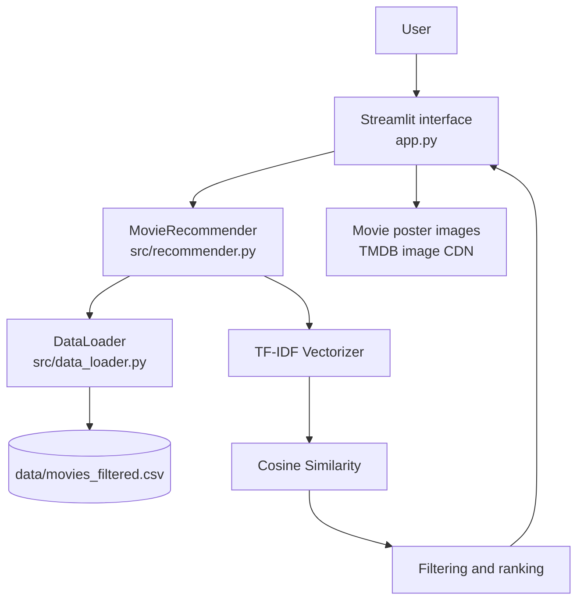

# 🎬 Movie Recommendation System

A content-based movie discovery application built with **Python**, **Streamlit**, and **Scikit-learn**. It recommends movies from their metadata using **TF-IDF** and **cosine similarity**.

<p align="center">
  
  
  
  
</p>

## Overview

The application helps users discover movies in two ways:

1. **Find similar movies:** Search for a movie by title, select it, and receive up to five recommendations.
2. **Recommend from a description:** Enter an English description of the kind of movie you are looking for and receive up to five matching recommendations.

The system uses movie metadata rather than user ratings or viewing history to calculate similarity.

## Screenshots

> Add fresh screenshots of the current Streamlit interface to `assets/screenshots/` using the filenames below. These image links will display once the corresponding files are added to the repository.

### Movie discovery and recommendations


### Recommendations from a description


### Filters and movie details


## Main Features

| Feature | Description |
|---|---|
| Movie discovery | Browse a starting selection of movies, using the most-voted or random view. |
| Title search | Search movie titles and choose from the matching results. |
| Similarity recommendations | Return up to five movies similar to the selected movie. |
| Text-based recommendations | Recommend movies from an English-language description. |
| Genre filter | Keep movies that match any of the selected genres. |
| Release-year filter | Limit the candidate movies to a selected year range. |
| Rating filter | Set a minimum movie rating. |
| Explanations | Show shared genres, keywords, and directors for title-based recommendations, or matching words for description-based recommendations. |
| Movie cards | Display posters, title, year, rating, genres, language, runtime, and overview when available. |

Filters are applied to the candidate movies before the top results are selected. They do not change the similarity scores.

## Recommendation Method

The project implements **Content-Based Filtering** with the following pipeline:

```text
Selected movie / English description
                |
                v
       Text representation
                |
                v
      TF-IDF Vectorization
                |
                v
       Cosine Similarity
                |
                v
      Apply candidate filters
                |
                v
       Rank similarity scores
                |
                v
       Return up to 5 movies
                |
                v
      Display explanations
```

### Text features

The text representation is built from four metadata fields:

- Overview
- Genres
- Keywords
- Directors

`TfidfVectorizer` converts these combined text features into numerical vectors. `cosine_similarity` compares the selected movie or description with the movie vectors. The vectorizer is fitted when the recommender is initialized and then reused for recommendation requests.

### Recommendation explanations

- **By title:** the application reports shared genres, keywords, and directors where available.
- **By description:** the application reports words from the user's description that also occur in the recommended movie's text representation.

## Architecture

The application is organized into three simple layers:



### Core components

| Component | Responsibility |
|---|---|
| `app.py` | Streamlit presentation layer: browsing, search, filters, movie cards, and results. |
| `DataLoader` | Reads the prepared CSV, handles missing runtime/year values, splits list-like metadata, and builds the combined text feature. |
| `MovieRecommender` | Fits TF-IDF, searches titles, filters candidate movies, calculates cosine similarity, ranks recommendations, and creates explanations. |
| `scripts/prepare_dataset.py` | Creates the filtered application dataset from the cleaned dataset. |
| `tests/` | Tests the data-loading and recommendation logic using a small synthetic dataset. |

## Technology Stack

| Technology | Purpose |
|---|---|
| Python | Main programming language |
| Streamlit | Interactive web interface |
| Pandas | CSV loading and data preparation |
| NumPy | Numerical operations used by the project and tests |
| Scikit-learn | TF-IDF vectorization and cosine similarity |
| Pytest | Automated unit tests |
| TMDB image CDN | Loads poster images from poster paths for display |
| Git & GitHub | Version control and project hosting |

## Dataset

The project was prepared from a combined TMDB/IMDb movie metadata dataset. The application uses these fields:

- `id`, `title`, and `poster_path`
- `release_date` and `overview`
- `genres`, `keywords`, and `directors`
- `original_language` and `runtime`
- `vote_average` and `vote_count`

The dataset preparation script keeps movies with **at least 100 votes** and writes the application-ready file to `data/movies_filtered.csv`.

### Dataset files required locally

**The dataset CSV files are not currently included in this GitHub repository.** The application therefore needs the prepared file to be supplied locally before it can run.

Expected local data layout:

```text
data/
├── movies_filtered.csv          # Required by app.py
└── processed/
    └── movies_cleaned.csv       # Input expected by prepare_dataset.py
```

To generate `movies_filtered.csv`, place `movies_cleaned.csv` at `data/processed/movies_cleaned.csv` and run:

```bash
python scripts/prepare_dataset.py
```

The script checks for the required columns and creates `data/movies_filtered.csv`. If that output file already exists, the script stops rather than overwriting it. The raw combined dataset and the earlier cleaning step are not part of this repository, so they must be obtained/prepared separately.

## Project Structure

The following tree reflects the files currently tracked in the GitHub repository:

```text
MovieRecommendationSystem/
├── .gitignore
├── README.md
├── app.py
├── requirements.txt
├── scripts/
│   └── prepare_dataset.py
├── src/
│   ├── __init__.py
│   ├── data_loader.py
│   └── recommender.py
└── tests/
    ├── Conftest.py
    ├── test_data_loader.py
    └── test_recommender.py
```

## Installation

### Prerequisites

- Python 3 (developed and tested with Python 3.13)
- Git
- The prepared dataset at `data/movies_filtered.csv`

### 1. Clone the repository

```bash
git clone https://github.com/alqadhi27/MovieRecommendationSystem.git
cd MovieRecommendationSystem
```

### 2. Create and activate a virtual environment

**Windows PowerShell**

```powershell
python -m venv .venv
.\.venv\Scripts\Activate.ps1
```

**macOS / Linux**

```bash
python3 -m venv .venv
source .venv/bin/activate
```

### 3. Install dependencies

```bash
python -m pip install -r requirements.txt
```

### 4. Add the prepared dataset

Place `movies_filtered.csv` in the `data/` directory. See [Dataset](#dataset) for the preparation path.

## Run the Application

From the project root:

```bash
python -m streamlit run app.py
```

Open the local URL printed by Streamlit, normally:

```text
http://localhost:8501
```

Poster images are loaded from the TMDB image CDN. An internet connection is required for posters to appear; movie recommendations themselves are calculated locally from the CSV dataset.

## Run Tests

Run the test suite from the project root:

```bash
python -m pytest -v
```

The tests use a small generated sample CSV rather than the full movie dataset. They cover data loading and cleaning, metadata splitting, text-feature construction, title search, recommendation ranking, filtering, and recommendation explanations.

> **Cross-platform note:** the current repository names the shared fixture file `tests/Conftest.py`. Pytest convention is `tests/conftest.py` (lowercase). Renaming it to lowercase is recommended before relying on test discovery on case-sensitive systems such as Linux.

## Scope and Limitations

- The description-based search accepts English text.
- Similarity is based on shared text features; the system does not understand meaning like a language model.
- The project uses content-based filtering; it does not implement collaborative filtering or user-personalized learning from watch history.
- Poster availability depends on the movie's `poster_path` and internet access.
- The application does not require a database or external AI service.

## Academic Context

An individual academic project focused on applying data preparation, object-oriented Python, content-based recommendation, an interactive Streamlit interface, and automated testing.

## Repository

[alqadhi27/MovieRecommendationSystem](https://github.com/alqadhi27/MovieRecommendationSystem)
